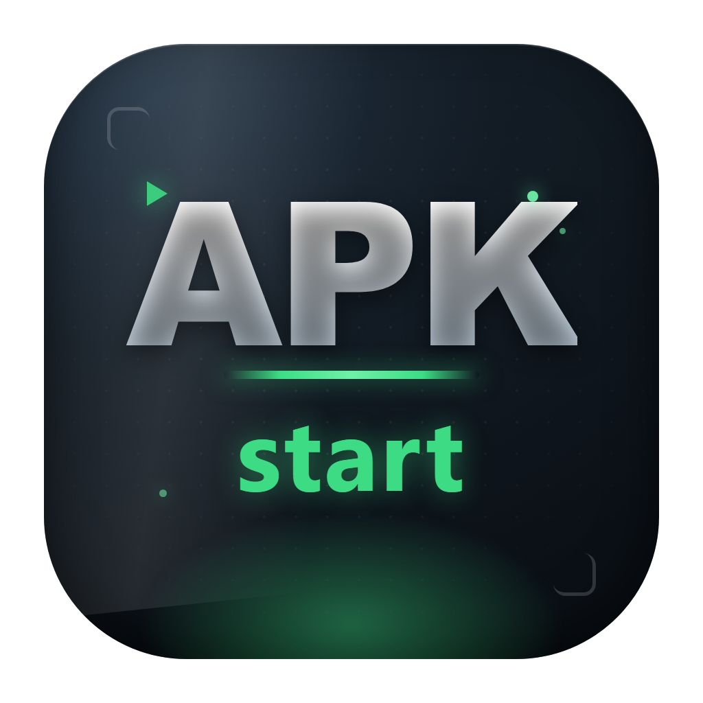

#Android #Windows #Emulator #APK #Electron #OpenSource

# ApkStart

<p align="center">
  
</p>

<p align="center">
  <strong>Запуск Android-приложений на Windows как нативных программ</strong><br/>
  Двойной клик по APK · иконка на рабочем столе · отдельное окно приложения
</p>

<p align="center">
  <a href="https://github.com/best-radar/bradar-apkstart/releases">Релизы</a>
  ·
  <a href="#установка">Установка</a>
  ·
  <a href="#возможности">Возможности</a>
  ·
  <a href="LICENSE">MIT</a>
</p>

---

## Что это

**ApkStart** - лёгкий раннер Android-приложений для Windows 10/11 x64. После установки APK появляется иконка на рабочем столе и в меню «Пуск»; двойной клик открывает приложение в отдельном окне с настоящим заголовком и иконкой пакета.

Проект на ранней стадии: open-source, без рекламы, развивается в свободное время. Зеркало на радаре Best Radar: [best-radar/bradar-apkstart](https://github.com/best-radar/bradar-apkstart).

## Возможности

- **Двойной клик по `.apk`** - ассоциация файлов: разбор манифеста, установка, иконка на рабочем столе без ручного открытия эмулятора
- **Одна иконка на приложение** - иконка извлекается из APK в многоразмерный ICO; запуск как у обычной Windows-программы
- **Окно приложения** - окно эмулятора переименовывается, получает иконку пакета и пропорции экрана; полноэкранный и оконный режимы с памятью размера
- **Поиск в Windows** - ярлыки на рабочем столе и в `Программы\ApkStart\`, группировка на панели задач
- **Общий каталог** - `%USERPROFILE%\ApkStartShared` ↔ `/sdcard/ApkStartShared` с двусторонней синхронизацией
- **Лёгкий каркас** - минимум зависимостей; runtime поднимается по необходимости и освобождается в простое
- **Ориентация экрана** - при установке парсится `AndroidManifest.xml`, подбирается портретная или ландшафтная панель эмулятора
- **Планшетная вёрстка** - плотность ~190 dpi (sw606dp) для двухколоночных UI; можно вернуть телефонный layout
- **Автообновления** - проверка в настройках или из трея, выбор более быстрого источника загрузки
- **Сеть хоста** - QEMU user-mode NAT без виртуальных адаптеров на Windows

## Требования

- Windows 10 / 11 x64
- [Node.js](https://nodejs.org/) 20+ (для сборки из исходников)
- Опционально: уже установленный Android-runtime на машине

## Установка

### Готовые сборки

Скачайте релиз с [страницы релизов](https://github.com/best-radar/bradar-apkstart/releases):

| Формат | Когда выбирать |
|--------|----------------|
| `ApkStart_*_x64.msix` | Microsoft Store / MSIX, runtime внутри |
| `ApkStart-v*-win64-full.zip` | Полный portable (~830 MB), runtime в архиве |
| `ApkStart-v*-Setup.exe` | Установщик с ярлыками и пунктом удаления |
| `ApkStart-v*-win64-portable.zip` | Лёгкий portable; runtime скачивается при первом запуске |

### Из исходников

```bash
git clone https://github.com/best-radar/bradar-apkstart.git
cd bradar-apkstart
npm install
npm start
```

Сборка пакетов:

```bash
npm run pack          # лёгкий portable
npm run pack:full     # полный portable с runtime
npm run build:msix    # MSIX для Store
```

## Как устроен запуск

```
Рабочий стол (.lnk с иконкой APK)
      │  двойной клик
      ▼
ApkStart.exe --launch <package>
      │  runtime не запущен? → Android Emulator + API 34
      ▼
LAUNCHER activity из системного разрешения
      │  наблюдение ~18 с, retry / reset / permissions
      ▼
Окно эмулятора = окно приложения (title, icon, aspect)
```

## Настройки

С версии 0.6.0 настройки сгруппированы:

| Раздел | Содержание |
|--------|------------|
| Частое и установка | runtime, автозапуск, диск и очистка |
| Экран и окно | режим, fullscreen, ориентация, планшетная вёрстка |
| Ввод | мышь, клавиатура / gamepad |
| Производительность | качество, snapshots, прогрев, advanced |
| Сеть и обновления | источники загрузок, зеркала |
| Приложения | права, ярлыки, данные |
| Отладка | логи, selftest |
| О программе | версия и ссылки |

По умолчанию: автозапуск в трей, ярлыки на рабочем столе и в меню «Пуск», автоправа при установке, retry при краше.

## Структура репозитория

```
src/          Electron main / preload / UI
engine/       логика runtime и launch
build/        pack, icons, MSIX, runtime prepare
docs/         руководства и скриншоты
assets/       встроенные APK (IME и др.)
test/         автотесты и probes
scripts/      selftest, ассоциации файлов
```

## Лицензия

MIT - см. [LICENSE](LICENSE).

---

Радар Best Radar: [github.com/best-radar/bradar-apkstart](https://github.com/best-radar/bradar-apkstart)
